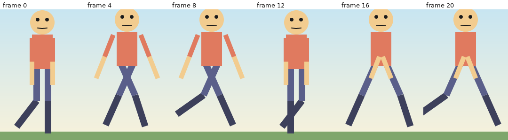

# ARMATURA animation guide

How to make things move, reuse motion, drive it from audio, faces, mocap and live input, check it, and
ship it small. Every command here was run against the real binary (`armatura 0.1.0`, debug build, Linux);
outputs are copied from those runs. Rigging is in [RIGGING_GUIDE.md](RIGGING_GUIDE.md); the first project in
[GETTING_STARTED.md](GETTING_STARTED.md); every flag in [CLI_REFERENCE.md](CLI_REFERENCE.md).

Licence of this document: CC-BY-4.0.

The examples use the 11-bone biped (`biped.json`, 400x360, 24 fps, 24 frames) from the rigging guide: separate
rectangles and circles attached to bones, a `mouth` switch layer with five children, built by one `script`
call. Any rig with similarly named bones works.



## 1. Channels and keys

Everything that moves is a **channel**: a target (bone, layer, camera, deformer point), a property, a
mode and a source.

```
{"target":"hand_ctrl","prop":"bone_offset_y","source":"keys",
 "track":{"keys":[{"frame":0,"value":0,"ease":{"type":"ease_in_out"}}, ...],"extrapolate":"hold"},
 "mode":"replace","weight":1.0}
```

* **Sources:** `keys` (keyframes), `expr` (an expression), `noise` (fractal value noise in `[-amp, amp]`, `freq` in
  cycles per second) and `driven` (a curve that maps another property's value to this one). Commands that bake
  (physics, walk, clips, lip-sync...) write ordinary `keys`. `armatura timeline` shows the source of every track:
  `#1 bone_offset_y (noise)`, `#0 bone_angle (expr)`, `#0 layer_switch (driven)`, or the list of key frames.
* **Modes:** `replace`, `add` (on top of whatever is below) and `multiply`. Channels combine in list order.
* **Extrapolate** (what a track does outside its first and last key): `hold` (default), `linear` (continue the end
  slope), `loop`, `ping_pong`, and `loop_offset` (repeat, adding the first-to-last change on every cycle, which suits a
  walking x offset). Set it with `keyedit ... extrapolate --channels 0 --extrapolate loop_offset`; a wrong name lists the valid ones.
* Bone properties are **deltas from the rest pose**: `bone_angle`, `bone_offset_x`, `bone_offset_y`,
  `bone_scale`. Layer properties include `layer_x`, `layer_y`, `layer_rotation`, `layer_scale_x`, `layer_scale_y`,
  `layer_opacity` and `layer_switch`. Deformers use `cage_dx`... as in the rigging guide.

Create keys from a script (`set_key(target, prop, frame, value[, ease])`), from the CLI with `keyedit add`, from the
studio, or in JSON.

```
$ armatura keyedit walk.json k3.json add --target torso --prop bone_angle --at 12 --value 6 --ease ease_in_out
add: 1 keys changed, wrote k3.json
```

`armatura timeline <project> [--json]` lists every track by bone/layer with its key frames; `armatura explain <project> <bone|layer> <frame>`
shows how one frame was computed.

## 2. Interpolation and easing

Each key stores the ease of the segment that **starts** at that key. The easing names that need no parameters are
`linear`, `step` (hold the value until the next key), `ease_in`, `ease_out`, `ease_in_out`, `smooth` (a Catmull-Rom
spline through neighbouring keys: smooth, no overshoot control) and `bounce`. In JSON an ease is an object:

```
{"type":"ease_in_out"}
{"type":"cubic_bezier","x1":0.25,"y1":0.1,"x2":0.25,"y2":1}    // CSS-style curve through (0,0) and (1,1)
{"type":"spring","bounces":3,"decay":4}                          // damped-spring settle that lands exactly on the target
{"type":"back","overshoot":0.6}                                  // ease out with overshoot
```

`keyedit ... ease --sel SEL --ease E` accepts a plain name, `bezier:x1,y1,x2,y2` (stored as `cubic_bezier`), or a JSON object for
`spring` and `back`; all four forms were applied to the 17 hip keys of the walk cycle without error. In the dope-sheet CLI the selection
syntax `SEL` is `target:prop@first..last`, `target:prop`, or `all`.

```
$ armatura keyedit walk.json k2.json ease --sel all --ease smooth
ease: 119 keys changed, wrote k2.json
```

Add `-` as the output to make any `keyedit` a **dry run** that prints the plan as JSON without writing anything:

```
$ armatura keyedit walk.json - move --sel 'thigh_l:bone_angle@0..6' --dt 2
{ "op": { "op": "batch", "ops": [ { "op": "set", "path": "/channels/0/track", "value": { "extrapolate": "loop", "keys": [ ... ] } } ] }, ... }
```

**Pitfall.** `keyedit` refuses edits that would leave the project's frame range unless you pass `--free`:
`scale: frame 27 is outside the project range 0..=24` (the same command with `--free` printed `scale: 17 keys changed`, and the
extra keys then sit beyond the last frame, where `lint` reports `L007`). Locked channels are refused too:
`channel hand_ctrl.BoneOffsetY is locked` (see `chan-meta ... lock=on`).

The studio's graph editor draws the same curves, with draggable tangents (`handle`, `smooth`; see
[STUDIO.md](STUDIO.md)). Keys have optional in/out tangent handles (`free`, `aligned` or `auto`).

## 3. The dope sheet from the command line: `keyedit`

Everything the studio's timeline can do exists as a `keyedit` sub-command, applied as one undo-safe batch:

| Sub-command | Effect |
|---|---|
| `move --sel SEL [--dt N] [--dv N] [--collision replace\|merge\|refuse] [--no-snap] [--free]` | shift keys in time and/or value |
| `scale --sel SEL --pivot F --factor X` | retime around a frame |
| `dup --sel SEL --offset N` | duplicate |
| `delete --sel SEL` | delete |
| `ease --sel SEL --ease E` / `value --sel SEL --value V` / `smooth --sel SEL [--kind monotone\|catmull_rom]` | set ease, value, or auto-smooth |
| `copy --sel SEL --clip clip.json` / `paste --clip clip.json --at F [--remap a:p=b:q]` | clipboard across projects |
| `add --target T --prop P --at F [--value V] [--ease E]` | insert a key |
| `ripple --at F --by N --mode insert\|delete [--scope 0,1] [--adjust-frames]` | insert or remove time |
| `offset --channels 0,1 --dt N` | slide whole channels |
| `extrapolate --channels 0,1 --extrapolate loop` / `loop --channels 0,1 [--end F]` | loop after the last key |
| `handle --sel SEL --side in\|out --t F --v V [--mode free\|aligned\|auto]` | graph tangent handle |
| `lock --target T [--prop P] [--value on\|off]` | lock a channel |

## 4. Loops

A project of N frames plays frames 0 to N-1 repeatedly, so **frame N must be the same pose as frame 0 and is never shown
twice**. Three commands help:

* `keyedit ... loop --channels 0,1` sets `extrapolate: loop` on channels (the keys are untouched):

```
$ armatura keyedit s4.json s6.json loop --channels 0,1
loop: 2 keys changed, wrote s6.json
```

* `loop-solve <in> <out> [--window 24] [--inclusive]` makes keyed channels loop seamlessly and reports the seam:

```
$ armatura loop-solve 04-keys.json buddy-final.json
wrote buddy-final.json: 2 channel(s) adjusted, seam 0.000 -> 0.000
```

* `make-loop <in> <out> [targets|all] [props] [--inclusive]` **removes travel** so the motion works in place:

```
$ armatura make-loop t1.json t2.json
ball LayerX: removed drift 280.00
wrote t2.json
```

That ball moved 280 units right in 23 frames. `make-loop` made it a perfect in-place loop... of a ball that no longer
moves (lint then reports `Info L005 [ball:LayerX] all keys have the same value; the channel never changes anything`).
That is what "removes travel" means: use it for walk cycles that move in place, then move the whole character with a
`follow` path or a camera (section 9). `loop-solve` does not fix travel: on the same ball it reports `seam 280.000 -> 280.000`.
If you want the travel to **continue** across cycles instead, give the channel the `loop_offset` extrapolation (section 1): `explain` then reports
`keys → 121.739 (2 key(s), LoopOffset outside range)` for the ball at frame 10.

`--inclusive` selects the older convention in which the last shown frame equals the first.

**Pitfall: noise does not loop.** A `noise` channel is not periodic. For a looping wobble use an expression of `t`
(0..1 over the clip) such as `8 * sin(t * 2 * pi)`, or break the loop deliberately.

## 5. Expressions, noise and drivers

An **expression** channel evaluates a small formula every frame. Variables: `frame`, `time` (seconds), `fps`, `frames`,
`pi`, and **`t` = 0..1 over the clip**. Operators `+ - * / % ^`, comparisons, `&& || !`, `?:`. Functions include
`sin`, `abs`, `min`, `clamp(x, lo, hi)`, `lerp(a, b, t)`, `wiggle(...)` (noise; two or three arguments, for example `wiggle(3, 5, 7)`)
and `get("target","prop")`, which reads another channel's current value (channels run in list order, and later ones see earlier results).

```
cat > ex.rhai <<'EOF'
add_channel_expr("head", "bone_angle", "8 * sin(t * 2 * pi)", "add");
add_noise("hips", "bone_offset_y", 1.5, 2.0, 7, "add");
EOF
armatura script biped.json ex1.json ex.rhai
```
```
2 request(s) applied; wrote ex1.json
```

Result of `explain ex1.json head <frame>`: the head's world angle is -90.0 at frames 0, 12 and 24, **-82.0 at frame 6**, and
-98.0 at frame 18 (one full sine over the clip; the head's rest angle is -90 world degrees). The noise on the hips
moves `hips` by a fraction of a unit: its head sits at y 169.7 at frame 0 and 170.5 at frame 24 (170.0 without the noise), so it does not loop (see above).

Mistakes are caught before anything is written:

```
$ armatura script biped.json ex2.json ex2.rhai       # "8 * sin(tt * 2 * pi)"
request 1 (channel head.BoneAngle) was rejected, nothing changed: channel 0 ('head'): expression error: unknown variable 'tt'
$ armatura script biped.json ex3.json ex3.rhai       # "8 * sin("
request 1 (channel head.BoneAngle) was rejected, nothing changed: channel 0 ('head'): expression error: unexpected end of expression
```

**Pitfall.** In an expression `t` is normalised (0 to 1), not seconds and not frames. `sin(t * 6.2832 / 24)` looks right
and is wrong: it barely moves. Use `time` for seconds or `frame`.

### Drivers, sliders and data bindings

* `slider` and `view-swap` (rigging guide) create controller bones plus `driven` channels.
* `bind` connects an external value path (from a game, UI or test) to a property or a state-machine input, with remap,
  smoothing and an optional expression:

```
$ armatura bind add m1.json b1.json look player.look head:bone_angle --remap 0,1,-20,20 --smooth 0.1
added binding 'look' (1 bindings); wrote b1.json
$ armatura bind add b1.json b2.json run player.running @hero:walking
$ armatura bind list b2.json
look  player.look -> head:BoneAngle remap 0..1 -> -20..20 clamp smooth 0.1s
run  player.running -> @hero:walking
$ echo '{"player.look":0.75,"player.running":0}' > vals.json
$ armatura bind-eval b2.json vals.json
look = 10
run = 0
```

`0.75` on the range 0..1 mapped to -20..20 is 10, as shown. `bind-eval --data out.json` writes the same numbers as JSON.

## 6. Walk cycles and the motion library

`walk` generates a procedural walk: it needs bone names for the legs and (optionally) arms and hips.

```
$ armatura walk biped.json walk.json --thigh-l thigh_l --thigh-r thigh_r --shin-l shin_l --shin-r shin_r \
    --arm-l arm_upper_l --arm-r arm_upper_r --hips hips --period 24 --stride 28 --knee 40 --bob 4 --swing 25
wrote walk.json (+7 channels)
```

`--period` is the cycle length in frames, `--stride` the thigh swing in degrees, `--knee` the knee bend, `--bob`
the hip bob in pixels and `--swing` the arm swing. The seven channels have a key every 1.5 frames, loop
(`extrapolate: loop`) and pass `lint` with 0 findings. Because the cycle is generated in place, there is no travel
to remove.

### Takes and clips

A **take** is a recorded piece of animation stored in a **library** file you can reuse across projects:

```
$ armatura take-record walk.json lib.json walk 0 24 thigh,shin,arm,hips
recorded 7 tracks into lib.json
$ armatura take-list lib.json
walk (24 frames, 7 tracks)
$ armatura take-apply biped.json ta.json lib.json walk 0
applied 7 tracks; wrote ta.json
```

The last arguments of `take-record` are target-name prefixes to include. `take-apply` writes the take starting at a frame,
with optional `from=to` renames, a `speed` and `--blend FRAMES` to cross-fade with existing animation.

### The clip stack: layering and weights

A **clip** is a take placed on the timeline with a mode, a weight and masks. Clips layer in order; later clips go over
earlier ones. Example: a walk, plus a waving right arm that fades in and out.

```
$ armatura clip add biped.json c1.json lib.json walk walkclip --at 0 --loops 1 --mode replace --weight 1
added clip 'walkclip' (1 clips); run clip bake to generate channels
$ armatura clip add c1.json c2.json lib.json wave waveclip --at 0 --mode replace --weight 1 \
    --include 'arm_*_r' --fade-in 4 --fade-out 4
$ armatura clip list c2.json
1. walkclip take 'walk' frames 0..24 x1 speed 1 Replace weight 1
2. waveclip take 'wave' frames 0..24 x1 speed 1 Replace weight 1 include arm_*_r
$ armatura clip bake c2.json c3.json
baked 2 clips into 18 channels (0 replaced); wrote c3.json
$ armatura clip set-weight c3.json c4.json waveclip --keys 0:0,6:1,18:1,24:0
updated clip 'waveclip'; run clip bake to update channels
```

The stack never touches hand-made channels or locked channels. `--include`/`--exclude` take name patterns,
`--track-weight arm_*=1,leg_*=0.2` weights tracks individually, `--mode additive|multiply` layers instead of replacing.

**Pitfall.** `clip bake` is what writes the channels: after changing clips run it again (the command says so).

## 7. State machines and bindings

A **state machine** chooses between clips at run time from inputs (booleans, numbers, triggers). It is described in JSON and
checked at add time:

```
{"name":"hero","inputs":[{"name":"greet","kind":"trigger"},{"name":"walking","kind":"bool","default":1}],
 "layers":[{"name":"base","entry":"walk",
  "states":[{"name":"walk","source":{"kind":"clip","clip":"walkclip"},"mode":"loop"},
            {"name":"wave","source":{"kind":"clip","clip":"waveclip"},"mode":"once","blend_in":0.15}],
  "transitions":[{"from":"walk","to":"wave","when":[{"input":"greet"}],"duration":0.15},
                 {"from":"wave","to":"walk","exit_time":1.0,"duration":0.2}]}]}
```

States play a clip, a frame `segment`, a marker `region`, or a 1-D `blend` of several; transitions fire when all
`when` conditions (`input op value`, AND) hold, optionally only after `exit_time` (0 to 1 of the state's length); the first
matching transition in order wins; `"from":"*"` means any state.

```
$ armatura machine add c2.json m1.json machine.json
added machine 'hero' (1 machines); wrote m1.json
$ armatura machine validate m1.json
1 machines, 0 bindings: ok
$ echo '{"duration":3.0,"events":[{"t":1.0,"trigger":["greet"]}]}' > script.json
$ armatura machine-sim m1.json script.json simout --fps 12
   0.000s  base     Entered walk
   1.000s  base     Exited walk
   1.000s  base     Entered wave
   2.000s  base     Exited wave
   2.000s  base     Entered walk
37 ticks at 12 fps, 5 events, 12 svg frames; wrote simout/sim.json
```

`machine-sim` replays timed input events and writes a state log (`sim.json`) plus SVG frames, so state machines are testable
and diffable without a runtime. A state machine is a pure function of its input log: the same script always gives the same
result.

## 8. Lip-sync and speech

All audio inputs must be **WAV**; convert other formats with ffmpeg first. Audio longer than the project is **truncated** to the
project length; lengthen the project first (`frames` in the file) or you get fewer frames than the sound has.

```
$ armatura lipsync biped.json speech.wav mouth ls.json
wrote ls.json (3.00s of audio → 24 frames)       # the project has 24 frames = 1 s: the last 2 s are cut
```

On a 72-frame copy of the project (3 s):

```
$ armatura lipsync talk0.json speech.wav mouth ls.json
wrote ls.json (3.00s of audio → 72 frames)
$ armatura lipsync-text talk0.json speech.wav transcript.txt mouth lt.json --lang en --words-out words.json
wrote lt.json (7 words, 18 exposure changes; energy + text alignment, not phoneme recognition)
$ armatura speech-motion lt.json speech.wav transcript.txt sm.json --head head --nod 4 --fall 3 --tilt 2 --seed 5 --lang en
wrote sm.json (1 additive channel(s) from 7 words)
```

* `lipsync` picks mouth shapes from the **loudness** of the audio alone.
* `lipsync-text` aligns your transcript (`Hello there, nice to meet you today`) to the audio's energy and uses the text for
  the shapes. It is **not phoneme recognition**; the tool says so each time. `--words-out` writes word and syllable timing
  as JSON or SRT: `00:00:00,220 --> 00:00:02,690  Hello there, nice to meet you today`. Languages: `--lang ro|en`.
* `speech-motion` adds head nods, falls and tilts timed on the words (additive).
* The shape order is rest, small, open, round, wide (`--map` remaps to your switch).

### Hand-made cues: `mouth`

If you have cues from another tool, `mouth <project> <cues.txt> <switch_layer> <out>` takes either
**frame-numbered** lines (Moho switch style: `frame PHONEME`) or **seconds** (Rhubarb TSV): a time **written with a decimal point
is seconds, a bare integer is a frame**.

```
printf '0.00 X\n0.20 C\n0.35 B\n0.60 D\n1.00 A\n' > cues.txt
armatura mouth talk0.json cues.txt mouth mc.json                 # wrote mc.json (5 cues)
armatura mouth talk0.json cues.txt mouth mc.json --rhubarb       # also wrote mc.json (5 cues)
```

Shape letters map to the five mouth classes: `X A MBP rest` to rest; `B G H L FV etc` (and unknown letters) to small; `D AI` to open;
`F O U WQ` to round; `C E` to wide. `--rhubarb` changes one thing: the letter `E` is then treated as Rhubarb's rounded shape (round) rather than
Papagayo's wide one. Here `X C B D A` gave rest, wide, small, open, rest.

**Pitfall.** `0.00 X` is seconds 0; `0 X` would be frame 0. Mixing them in one file is legal and confusing.

### Audio-reactive and beats

```
armatura audio-react biped.json ar.json speech.wav head bone_angle gain=10 add=on   # loudness drives a property
armatura beats biped.json bt.json speech.wav as=markers name=syl                    # 2 beats at frames [5, 14]
armatura sound add biped.json s1.json voice speech.wav 0 1.0
armatura sound mix s1.json mix.wav                                                  # wrote mix.wav (1.00 s)
```

`sound mix` also truncates to the project length (a 3 s sound became 1.00 s of a 1 s project). `export` to `.html` embeds the mixed
sound as mp3 (this project's page grew from 50 KB to 131 KB), which needs `ffmpeg`; without it the page is written without sound. `.mp4`,
`.webm` and mp3/ogg mixing need `ffmpeg` too.

## 9. Moving things along paths, follow-through, foot-lock

* **Path follow:** draw a line layer, then `follow <in> <out> <layer|bone:NAME> <path_layer> <start> <end> [no-orient]` keys position
  and (unless `no-orient`) rotation along it:

```
cat > path.rhai <<'EOF'
add_line("route", [40, 300, 120, 260, 200, 290, 300, 240, 360, 280], "#bbbbbb", 2, false);
add_circle("ball", 0, 0, 10, "#c1121f");
EOF
armatura script biped.json p0.json path.rhai
armatura follow p0.json p1.json ball route 0 23         # 3 channels: layer_x, layer_y, layer_rotation
```

(`add_line` needs three or more points: `points need an even number of coordinates: 3..1000 points`.)

* **Chain follow-through:** `follow <in> <out> --target SRC --prop P --chain a,b,c [--delay F --decay X]` copies a driver's motion to a
  chain of followers, each later and weaker (overlapping action, tails, antennae):

```
$ armatura follow walk.json fo.json --target hips --prop bone_offset_y --chain torso,head --delay 2 --decay 0.6
wrote fo.json (+2 channels)
```

  Followers' keys are shifted later by the delay, so some land beyond the last frame (`lint`: `Info L007 [head:BoneOffsetY] key at
  frame 25 lies outside the 0..24 timeline`) and rely on the copied looping.
* **Foot-lock:** keep a foot planted while the body moves. It needs a **root controller** (a bone with no parent) and
  an IK foot goal:

```
cat > ctrl.rhai <<'EOF'
add_bone("root_ctrl", "", 10, 200, 312, 0);
add_bone("foot_goal_l", "", 10, 212, 312, 0);
add_ik("leg_ik_l", ["thigh_l", "shin_l"], "foot_goal_l", -1);
EOF
armatura script biped.json fl0.json ctrl.rhai
cat > fl1.rhai <<'EOF'
set_key("foot_goal_l", "bone_offset_x", 0, 0);
set_key("foot_goal_l", "bone_offset_x", 12, -40);
set_key("foot_goal_l", "bone_offset_x", 24, 0);
set_key("foot_goal_l", "bone_offset_y", 0, 0);
set_key("foot_goal_l", "bone_offset_y", 6, -15);
set_key("foot_goal_l", "bone_offset_y", 12, 0);
set_key("foot_goal_l", "bone_offset_y", 24, 0);
EOF
armatura script fl0.json fl2.json fl1.rhai
$ armatura foot-lock fl2.json fl3.json foot_goal_l 312 1 2
contact frames 12..23 pinned at (172.0, 312.0)
wrote fl3.json
```

  `foot-lock <in> <out> <ctrl_bone> <ground_y> [tolerance] [min_frames]` finds frames where the controller touches the ground
  and adds compensating channels (mode `add`) so it does not slide. Without a parentless controller it stops:
  `foot lock needs a root controller bone (no parent)`.
* **Related bakes:** `stretch <in> <out> <follower> <leader>` (follower aims and stretches to the leader), `magnet <in> <out> <ctrl>
  <bone:NAME|x,y> <radius> <strength>` (proximity pull), `bone-vis` (overlay visibility).

## 10. Face tracking and its limits

**Be honest about what this is.** ARMATURA contains its own small face detector and landmark model (23 landmarks, layout
`armatura23`). It is built into the binary, runs locally, needs no downloads, and was **trained only on faces generated
by this project's own synthetic generator**: stylised and cartoon heads. It is **not validated on photographs, webcams or real
video.** The measured figures (`armatura face-eval --eval-n 50 --seed 9`) are:

| Measure | Result |
|---|---|
| Held-out synthetic faces, detection rate | 1.0 (50 of 50) |
| Landmark error (NME) mean / median / 90th percentile | 0.028 / 0.026 / 0.046 |
| False positives on 50 scenes with no face | 2 |
| Cartoon designs, NME where detected | round-emoji 0.164, manga-oval 0.166, line-drawing 0.105 |
| Cartoon designs, detected | round-emoji 6/6, manga-oval 6/6, line-drawing 6/6, **boxy-robot 0/6** |

Those figures are for *its own synthetic style*. Do not read them as accuracy on a person in front of a camera. If you
need real-face tracking, produce landmarks with a tool you trust and feed them in as NDJSON (the `face-bake` input format
is open); the studio's Face panel expects you to supply a `window.armaturaLandmarkProvider` function for camera input.

The pipeline:

```
armatura face-synth face --frames 60 --size 160 --seed 7        # synthetic head animation: PNG frames, truth.ndjson, params.json
armatura face-track face face/track.ndjson --fps 24             # wrote face/track.ndjson: 60 frames, face found in 60
armatura face-bake biped.json face/track.ndjson facemap.json fb.json --fps 24
```
```
60 landmark frames -> +2 channels (K keys in them), 0 trigger keys set, 2 events; wrote fb.json   # K = number of keys in the 2 new channels
```

with a mapping file (here `facemap.json`):

```
{"face": {"mincutoff": 3.0},
 "params": [
  {"source":"face","id":"head_yaw","target":"head","prop":"bone_angle","out_min":-20,"out_max":20},
  {"source":"face","id":"mouth_open","target":"mouth","prop":"layer_scale_y","out_min":0.6,"out_max":1.8}
 ],
 "triggers": [
  {"source":"face","id":"eye_r_open","edge":"release","threshold":0.5,"action":{"type":"fire_event","name":"blink"}}
 ]}
```

Signal ids: `head_yaw`, `head_pitch`, `head_roll`, `eye_l_open`, `eye_r_open`, `mouth_open`, `mouth_wide`, `mouth_round`,
`brow_raise`, `brow_l_raise`, `brow_r_raise`. A wrong id lists the valid ones: `map 0: unknown face signal 'yaw' (known: head_yaw, head_pitch, ...)`.
`face-bake` calibrates the neutral face from the first frames (`--calibrate-frames`, `--calib`).

**Things to know.** The bake is **truncated to the project length**: 60 landmark frames onto a 24-frame project
produced keys 0 to 23 only, and a stderr warning says how many recording frames were not baked (the project length is unchanged). The summary line shows `(K keys in them)` for the new channels; `N trigger keys set` counts keys written into pre-existing channels. `face-detect <image> --overlay o.png` shows what the detector found on a still.

## 11. Mocap and BVH

```
$ armatura mocap-info walk.bvh
11 joints (5 end sites), 36 channels per frame
48 frames at 0.0417 s (24.000 fps), duration 1.958 s
Hips  offset (0.000, 95.000, 0.000)  [Xpos Ypos Zpos Zrot Xrot Yrot]
...
$ armatura mocap-match biped.json walk.bvh
slot         bvh joint                  rig bone                conf  via         len x  note
hips         Hips                       hips                    1.00  name         2.00
head         Head                       head                    1.00  name         4.00
shin.l       LeftLeg                    shin_l                  0.63  name         7.20  limb length ratio is 2.1x off the median
...
$ armatura mocap-retarget biped.json walk.bvh mo.json --view side --smooth 2 --weight 1
note: project length extended from 24 to 48 frames
11 bones, 48 frames at 24 fps, root scale 2.7692, +13 channels; wrote mo.json
```

* A 2D rig can only use one projection of 3D motion: `--view front|side|top|yaw=DEG` chooses it.
* `mocap-match` prints a confidence table (the `shin` rows above carry a note because their limb length is 2.1 times off the median).
  `--map map.json` overrides the guess and `--min-conf C` sets the confidence below which a joint is not used.
* **`mocap-retarget` lengthens the project** to fit the clip (24 became 48 frames; a note says so, and `--keep-length` truncates the clip instead). `--in-place` removes the root travel,
  `--footlock BONE --ground Y` pins a foot (it needs the parentless root controller, like `foot-lock`: `foot lock needs a root controller bone (no parent)`),
  and `--mirror` mirrors the motion.
* `import-bvh` is the older, explicit form with `--joint-map Joint=bone,...`.

## 12. Live input (MIDI, mouse, gamepad, keys)

Record a performance in the studio's Live panel, or replay a recording or a MIDI file offline:

```
cat > lmap.json <<'EOF'
{"params":[{"source":"midi_cc","id":"1:1","target":"arm_upper_r","prop":"bone_angle","in_min":0,"in_max":1,"out_min":0,"out_max":160,"smooth":0.2}],
 "triggers":[{"source":"midi_note","id":"1:60","edge":"press","threshold":0.5,"action":{"type":"fire_event","name":"cymbal"}}]}
EOF
armatura live-map biped.json wheel.mid lmap.json lm.json
```
```
27 events -> +1 channels (K keys in them), 0 trigger keys set, 0 takes, 1 events (0 after the last frame skipped); wrote lm.json
```

The mod-wheel (CC 1 on channel 1) swept the arm from 0 to 160 degrees through 24 baked keys, and the note on at 0.5 s became the project
event `cymbal` at frame 12. Sources are `midi_cc`, `midi_note`, `midi_pitch_bend`, `mouse_x`, `mouse_y`, `mouse_button`,
`gamepad_axis`, `gamepad_button`, `key` and `face`. MIDI ids are `"<channel>:<number>"` with channels from 1. Web MIDI in the
studio needs a browser that supports it (see [STUDIO.md](STUDIO.md)); the offline command only needs the file.

## 13. Layout containers and scroll

Layout containers re-flow layers to a different canvas size (responsive UI animation); scroll regions add clamped or elastic
scrolling. Containers are JSON and the solver is deterministic:

```
$ cat cont.json
{"id":"faces","axis":"row","gap":12,"padding":[10,10,10,10],
 "rect":{"kind":"pin","left":10,"right":10,"top":10,"height":100},
 "members":[{"layer":"eye_l"},{"layer":"eye_r","grow":1}]}
$ armatura container add biped.json c1.json cont.json
added container 'faces' (1 containers); wrote c1.json
$ armatura container solve c1.json --size 800x360
canvas 800x360
container faces: x 10.00 y 10.00 w 780.00 h 100.00
layer eye_l: dx -186.000 dy -44.000 scale 1.0000 x 1.0000
layer eye_r: dx -146.000 dy -44.000 scale 1.0000 x 1.0000
$ armatura layout-preview c1.json lp.svg --size 800x360
wrote lp.svg (800x360, 1 containers, 2 layers placed)
```

`dx`/`dy` are offsets applied on top of the animation. Details of containers, `scroll add|list|remove|eval` (elastic limits, snap points, fling
simulation) are in [CLI_REFERENCE.md](CLI_REFERENCE.md#scroll-add-list-remove-eval). The layout is applied by the runtime and previews;
**exported files hold the layout solved for the project's own size.**

## 14. Camera, shots, depth of field

```
armatura shot walk.json sh1.json wide 200 180 1          # name x y zoom [rotation]
armatura shot sh1.json sh2.json close 200 100 2.2
armatura camera-seq sh2.json sh3.json 0:wide,12:close,23:wide
armatura parallax sh3.json px.json sky,ground 0.2 1.0
armatura dof px.json 12 dof.png --focus 1.0 --strength 10
armatura dof-export px.json dof.gif --from 0 --to 11 --scale 0.5
```

`timeline sh3.json` shows 11 channels: the walk's 7 plus the camera's. `dof` blurs each top-level layer by `|parallax - focus|`
(strength and radius are capped by `--max-radius`, default 24). Depth of field is a post-process render; `dof-export` writes it to a
GIF, APNG or folder.

## 15. Layer effects

Effects are an ordered list on a layer (blur, drop shadow, tint, fill) rendered in an isolated pass before the layer's mask, opacity and blend
mode, up to 16 per layer. Their numbers are animatable with channels targeted `"<layer>::fx<index>"` and one of the properties `fx_blur`, `fx_dx`,
`fx_dy`, `fx_soft`, `fx_amount` (colours are not animatable):

```
"effects":[{"type":"drop_shadow","dx":4,"dy":6,"blur":8,"color":"#00000099","opacity":0.8}]      // on layer "head"
{"target":"head::fx0","prop":"fx_dx","source":"keys","track":{"keys":[{"frame":0,"value":-6},{"frame":24,"value":6}]}}
```

`check` passes and the shadow slides from -6 to +6 over the loop. A **post-effect chain** (outline, posterize, relight with normal maps...) renders one
frame from a JSON list instead:

```
$ echo '[{"type":"outline","width":3,"color":"#222222"},{"type":"posterize","levels":6}]' > chain.json
$ armatura fx biped.json 0 chain.json fxc.png
wrote fxc.png (2 effect(s))
```

Safety checks for flashing and camera motion (an engineering aid based on the public WCAG 2.3.1 definition, **not a broadcast certification**):

```
$ armatura safety walk.json
flashes      ok    worst 0 transitions/s (frame 0)
red flashes  ok    worst 0 transitions/s (frame 0)
camera       pan 0.00 widths/s, rotation 0°/s, zoom ×1.00/s
$ armatura reduced-motion walk.json rm.json --factor 0.25
wrote rm.json
```

## 16. Onion skin and trails (overlays)

```
armatura onion p1.json 12 onion.png --before 3 --after 2                  # ghosts of neighbouring frames, raster
armatura onion p1.json onion.svg --frame 12 --before 3 --after 2 --keyed --outline   # SVG; --keyed ghosts key frames
armatura trail p1.json trail.svg --target layer:ball --from 0 --to 23     # wrote trail.svg (24 ticks, 24 key marker(s))
```

`--keyed` draws ghosts at the neighbouring *key* frames rather than a fixed step. Overlays never change the project and are not part of an export.
The studio shows them live (`Alt+N` onion, `Alt+M` trails, `Alt+7` panel).

## 17. Procedural idles

```
armatura idle blink  p1.json i1.json --target eye_l --prop layer_scale_y --interval 2 --seed 4 --closed 0.1
armatura idle breath p1.json i2.json --target torso  --prop bone_scale   --amp 0.03 --period 48
armatura idle sway   p1.json i3.json --target head   --prop bone_angle   --amp 3 --freq 0.5 --seed 2
```

Seeded, so the same command yields the same animation anywhere. `autorig` adds breathing and blinking for you when the names match.

## 18. Quality assurance: check, lint, fuzz, CI

* `check` compiles the project exactly as the renderer will. Exit 1 on error.
* `lint` finds static problems (exit 1 on errors; information and warnings do not fail): unreachable IK targets (`L003`), channels that
  never change (`L005`), keys outside the timeline (`L007`)...
* `explain`, `coach`, `diff a.json b.json` (`+` added, `-` removed, `~` changed) and `vcs` (version control with semantic merge for project files).
* **Fuzz** poses the rig at random and reports where it breaks:

```
$ armatura fuzz walk.json --samples 200 --seed 3 --strategy lhs --only thigh_l,shin_l,arm_upper_l
fuzz 'Biped': 200 samples (lhs, seed 3, frame 0), 12 parameters, 22 failures (11.0%), max severity 1.00, baseline 0.00, 0.78 ms/sample
  off_canvas: 22
  extreme-range failure excess  arm_upper_l              28%
  extreme-range failure excess  thigh_l                  9%
  extreme-range failure excess  shin_l                   2%
  strongest interaction: bone:arm_upper_l:scale + bone:arm_upper_l:offx (cell failure rate 53% over 17 samples)
fuzz: failure rate 11.00% exceeds --max-fail-rate 5.00%
```

  **Plain `fuzz` is a report and exits 0; add `--gate` (any failure exits 1) or `--max-fail-rate R` (a fraction) to gate.** The sampling range is the full range of each parameter, so a rig with IK
  fails in nearly all samples (`98.0%`, 48 of 50 `ik_unreachable`, on the foot-locked biped). Restrict with `--only`, `--props`,
  `--margin` and `--ignore KINDS`, choose the range you consider legal, and set the threshold you accept.
  `--report out.json`, `--heatmap out.svg` and `--minimize` (smallest reproducing pose) help. Strategies: `random`, `lhs`, `halton`, `sweep`, `corners`, `pca`.
* **Goldens and CI.** `golden write walk.json gold.json` stores frame signatures; `golden check` compares exactly by default (exit 1 on any
  change; `--tol T` loosens it). Checking a *different* animation against them lists the frames that differ: `frame 4 differs: pixel hash changed, thumbnail distance 0.013, ...`, ...
  `ci` wraps this and more in a manifest:

```
$ armatura ci init walk.json --out armatura-ci.json
wrote armatura-ci.json with 9 checks:
  validate / render frames / render frames-float / determinism / pose-fuzz / limits / gif-size / loop-seam / render-speed
$ armatura ci run armatura-ci.json
[PASS   ] validate     validate           project compiles; 0 lint finding(s), none at 'error' or above
[PASS   ] render       frames             6 frame(s) match
[PASS   ] render       frames-float       2 frame(s) match
[PASS   ] determinism  determinism        6 render(s) repeated byte-identically
[PASS   ] fuzz         pose-fuzz          44 of 100 pose samples fail (44.00% <= 46.00%)
[PASS   ] limits       limits             within all limits
[PASS   ] export-size  gif-size           gif export is 106945 bytes (budget 160418)
[PASS   ] loop         loop-seam          seam 1.728% vs mean step 1.178%
[INFO   ] perf         render-speed       median 64.52 ms/frame, budget 534 ms (+50% tolerance = 801.00 ms)
9 checks: 8 passed, 0 failed, 0 errors, 1 info, 0 updated, 0 blessed (4.9 s)
```

  `ci run` exits 0 when everything passes, 1 when a check fails and 2 on an error. `ci bless` accepts the current renders as the new golden frames,
  `ci diff a.png b.png --metric ssim|de2000|de76|mse` explains a change with heat maps. The pose-fuzz threshold of 46 % in the manifest was calibrated to the
  project "as it is now" (the tool prints that note); tighten it deliberately. Details are in [CI.md](CI.md).

## 19. Size and level of detail

```
$ armatura size-report walk.json | head -9
project file: 17507 bytes (2185 gzip)
  by layer (JSON bytes; embedded image base64 in brackets):
         2658  mouth
          643  mouth/m_small
           ...
  by channel (keys, removable at tol 0.05000000074505806):
         1116  thigh_r.BoneAngle  keys 17 removable 1
```

`size-report` shows which layers, images and channels cost bytes. When a platform has a budget, `export-fit` finds the best-quality export that fits:

```
$ armatura export-fit walk.json fit.gif --max-size 60KB --format gif
gif -> fit.gif: 44540 bytes raw, 43822 gzip (budget 60000 raw); SSIM mean 0.9271, worst 0.9057 at frame 3, max CIEDE2000 74.98; 8 candidates built
time budget exhausted (60 s, checked inside every candidate): the search stopped early and the best result so far is kept (exit code 0 if it fits the size budget, 1 if not; ...)
$ armatura export-fit walk.json fit.json --max-size 8KB --format lottie
lottie -> fit.json: 14952 bytes raw, 1429 gzip (budget 8000 raw); SSIM mean 0.9350, worst 0.9060 at frame 10, max CIEDE2000 74.98; 5 candidates built
existing exporter at defaults: 76430 bytes raw, 6654 gzip
budget not met: the smallest export found is 14952 bytes (raw), above the budget of 8000 bytes: every knob is at its floor ...
```

The second command exited **1** and still wrote the smallest file it found (14952 bytes). Budgets are checked on the raw size by default;
`--measure gzip` checks the compressed size (the Lottie above is 1429 bytes gzipped). The search is bounded by `--max-seconds` (default 60 s of real time);
in the debug build the GIF search was stopped by that limit and kept its best result.

For drawings with many curves and meshes, **level of detail** produces simplified copies with a *declared* error bound in output pixels:

```
$ armatura lod walk.json --tolerance-px 0.5 --levels 3 --out-dir lods --verify
level  tol_px  anchors  mesh_v  keys  layers    bytes  declared_px  ...  measured_px  ratio
L0      0.000       75       0   119      20    17507       0.0000  ...            -      -
L1      0.500       72       0   100      20    16193       0.1153  ...       0.0895   1.3x
L2      1.000       70       0   100      20    16040       0.3969  ...       0.3597   1.1x
L3      2.000       69       0   100      20    16080       0.5570  ...       0.4997   1.1x
$ armatura lod-pick walk.json --screen-px 200x180 --max-px 0.5
screen 200x180 -> scale 0.5000 px/unit; budget 0.5 px -> level L3 (declared 0.2785 px, 69 anchors, 0 mesh vertices, 100 keys)
```

`--verify` measures the real deviation (exit 1 if it exceeds the bound); in the run above every measured error was below its declared bound. Note how
little a tiny rectangle-based project saves (17507 to 16080 bytes): LOD pays off on detailed art, not on this one.

## 20. Honest limits

* Lip-sync is energy plus text alignment, not phoneme recognition.
* The face detector is synthetic-only (section 10): it does not make a webcam performance usable by itself.
* `make-loop` removes travel; `loop-solve` does not fix it; noise does not loop.
* Audio is truncated to the project length; `mocap-retarget` lengthens the project.
* Lottie, GIF and HTML cannot carry every feature; export warnings and `--report` list what was approximated ([EXPORT_FORMATS.md](EXPORT_FORMATS.md)).
* Only Chromium was tested for the studio ([STUDIO.md](STUDIO.md)).
