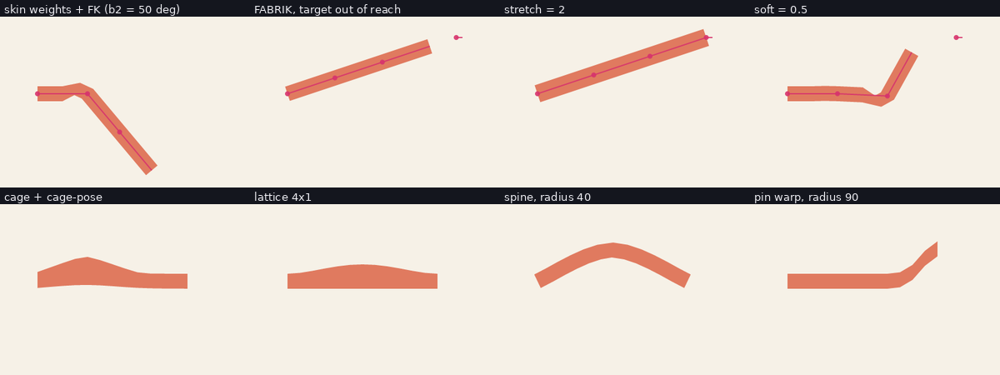

# ARMATURA rigging guide

This guide covers everything that makes a drawing move: bones, constraints, inverse kinematics,
skinning, deformers, physics, auto-rigging, mirroring, view swapping, face rigs and camera work.
Every example was run against the real binary (`armatura 0.1.0`, debug build, Linux) and the numbers
quoted are the numbers it printed. If you have not built a first project yet, do
[GETTING_STARTED.md](GETTING_STARTED.md) first. Flags of every command are in
[CLI_REFERENCE.md](CLI_REFERENCE.md); the file format is in [PROJECT_FORMAT.md](PROJECT_FORMAT.md).

Licence of this document: CC-BY-4.0.



*Contact sheet of the examples below: skin weights with FK, FABRIK with an unreachable target,
`stretch = 2`, `soft = 0.5`, cage, lattice, spine and pin deformers.*

## 1. Two ways to edit a rig

* **Commands and `script`.** Most rig edits have a command (`autorig`, `cage`, `physics`, `skin`...) or
  a Rhai function in `armatura script` (`add_bone`, `add_ik`, `add_aim`, `add_copy_rotation`, `add_pin`,
  `set_layer`, `set_bone`, `set_parent`, `delete_bone`...). A script is all-or-nothing: if any request is
  rejected nothing is written. A script may contain at most 5000 requests.
* **JSON.** A few things have no command or script setter: IK `soft` and `stretch`, springs, vector
  deformers (lattice, spine, pin) and per-anchor skin weights. Edit the project JSON (any editor, a
  Python script, or the studio's JSON panel) and run `armatura check` afterwards.

`check`, `lint`, `explain` and `render --bones` are the four commands you will use constantly while rigging.
`explain` is the most valuable: it lists, in order, every rest value, channel, constraint and IK
contribution that produced one bone's final transform, so you never have to guess why something is where it is.

```
$ armatura explain con1.json b3 0
- bone 'b3' (length 80), parent 'b2'
- ancestry: b3 ← b2 ← b1
- rest pose: offset (80.00, 0.00), angle 0.00°
- no channels animate this bone directly
- constraint 'b3_aims' (Aim { target: "target", offset: 0.0 }) at weight 1.00
- result at frame 0: head (203.6, 101.4), tip (173.5, 27.3), world angle -112.1°
```

## 2. Bones and hierarchies

A bone has a `name`, a `parent` (none = root), a `length`, a `rest_offset` (where its head sits, in the
**parent's** frame; for a root bone this is the canvas) and a `rest_angle` in degrees relative to the
parent. Conventions:

* y points down; angle 0 points along +x; positive angles turn clockwise on screen; **90 is down, -90 is up**.
* `rest_offset` is rotated by the parent's world angle. A child of a bone that points up and has
  `rest_offset` (70, 0) sits 70 units *up the parent*, not 70 units to the right of the canvas.
* Bones must be listed parents-first. Anything else is rejected:
  `bone 'a' has parent 'ghost' which is missing or listed after it`.

Animation channels on a bone are **deltas from the rest pose**: `bone_angle`, `bone_offset_x`,
`bone_offset_y`, `bone_scale`. A key value of 0 means "rest".

A minimal 3-bone chain used by most examples below (`lab.json`; it is generated, see section 4):

```
b1  root, length 80, head at (60,150), angle 0
b2  child of b1, rest_offset (80,0)
b3  child of b2, rest_offset (80,0)
```

Useful commands: `reparent <in> <out> <bone> <new_parent|none>` keeps the rest pose (I checked: `b3`
stays at head (220,150) when reparented to none), `set_parent` in a script is the lower-level form, and
`bone-vis <in> <out> <bone> <from> <to>` shows a bone in overlays only for a frame range.

### Rigid attachment: the simplest rig

A layer can ride a bone rigidly with `set_layer("layer", "bone", "bone_name")`. This is how the
tutorial character and the biped below are made: separate pieces, each attached to a bone. It needs no
weights and survives every export. Choose it when your art is already cut into pieces.

**Pitfall.** Attach layers while the bones are in their rest pose and draw each piece so its joint sits
on the head of its bone. A piece that is drawn a few units off will swing about the wrong point.

**Pitfall.** Do not set the arm bones' rest angle to ±100 "to get a T-pose" with a rest offset of 0: the
two arms start from one point. Give each shoulder a lateral `rest_offset` and an angle of 180 or
0, as in the biped (`add_bone("arm_upper_l", "torso", 50, 62, 22, 180)`).

## 3. Constraints

Constraints are listed in the project's `constraints` array and run **in list order** after the
channels. Create them with `add_aim`, `add_copy_rotation` and `add_pin` (script) or in JSON.

| Constraint | Script | Effect |
|---|---|---|
| Aim | `add_aim(name, bone, target[, offset, weight])` | rotate `bone` so it points at the head of the `target` bone |
| Copy rotation | `add_copy_rotation(name, bone, source, weight)` | `bone` takes (a weighted share of) the world rotation of `source` |
| Pin | `add_pin(name, bone, target, weight)` | move `bone`'s head onto the `target` head |

Verified with the 3-bone chain, `target` a bone at (250,40):

```
add_aim("b3_aims", "b3", "target", 0, 1);        // weight 1   -> world angle -74.7 deg
add_aim("b3_aims", "b3", "target", 0, 0.5);      // weight 0.5 -> world angle -37.4 deg
```

Weight blends linearly between the animated angle and the constrained angle, so 0.5 halves the turn.

Angle limits are bone properties (`set_bone(name, "angle_min", -20); set_bone(name, "angle_max", 20)`).
They clamp the **animated** rotation: key `b1` to 60 degrees and it is held at 20:

```
$ armatura explain l2.json b1 12
- channel #0 BoneAngle: keys → 60.000 (2 key(s), Hold outside range); mode replace, weight 1.00
- angle limits: animated rotation is clamped to [-20, 20]°
- result at frame 12: head (60.0, 150.0), tip (135.2, 177.4), world angle 20.0°
```

**Pitfall: order matters.** A copy-rotation placed on the *parent* of an aimed bone interacts with the aim.
If a bone ends up pointing somewhere strange, run `explain` on it and its parent and read the contribution
list top to bottom, then reorder the `constraints` array.

## 4. Inverse kinematics

```
add_bone("goal", "", 10, 200, 60, 0);
add_ik("chain", ["b1","b2","b3"], "goal", 1);   // name, bones root->tip, target bone, bend
```

* Two bones: an analytic solver. `bend` (+1 or -1) chooses which way the joint folds.
* Three or more bones: FABRIK. `iterations` is a floor; the solver stops early once the tip is within
  0.01 px and otherwise runs up to a hard cap.
* `mix` is the FK/IK blend (0 = the keyed FK pose, 1 = full IK). It can be animated with the `ik_mix`
  property, which is how an arm switches between FK and IK. `autorig` adds chains with `mix 0` so existing
  FK animation keeps working.
* The target is the **head** of a bone; give it no art and a small length (`goal`, `hand_ctrl`).

### Unreachable targets: straight, soft, stretch

The chain `b1..b3` has reach 240 from its root (60,150). Moving the goal to (330,60), 285 away:

| Setting | Result (tip position) |
|---|---|
| default | fully extended toward the goal, tip (287.7, 74.1), exactly 240 from the root |
| `"stretch": 2` | the chain lengthens, tip reaches (330.0, 60.0) |
| `"soft": 0.5` (3 bones) | the chain stays kinked, tip (258.8, 83.7); it does not straighten |

`soft` (0 to 0.9) and `stretch` (1 to 4) are fields of the IK chain in the project JSON; there is no
command or script setter:

```
python3 - <<'EOF'
import json
d = json.load(open('03-ik.json'))        # the Buddy project of GETTING_STARTED.md
d['ik'][0]['soft'] = 0.5                 # or: d['ik'][0]['stretch'] = 1.5
json.dump(d, open('ik_soft.json', 'w'))
EOF
armatura check ik_soft.json
```

On the Buddy arm (reach 80 from the shoulder at (160,140)) with the goal at (250,140), 90 away:

```
soft 0,   stretch 1    tip (240.0, 140.0)    straight, 10 short of the goal
soft 0.5, stretch 1    tip (228.5, 140.0)    held back, elbow still bent
soft 0,   stretch 1.5  tip (250.0, 140.0)    arm lengthened, goal reached
```

Soft IK on a two-bone limb approaches full extension asymptotically: as the goal moves out to 100, 120,
135 and 150 away the tip x settles at 231.1, 234.6, 236.3 and 237.4 and never reaches 240. This is the
intended "no knee pop" behaviour. With `stretch` above 1 as well, the soft zone is the last `soft` fraction of the
stretched reach (`reach x stretch`): the chain lengthens continuously and eases into its maximum length (before wave 7
`soft` was ignored beyond full reach and the chain popped straight at that point).

**Pitfall.** `lint` reports unreachable targets as information, not as errors:
`Info L003 [leg_ik_l] target 'foot_goal_l' is out of reach at frame 12 (148 px > 144 px); the chain will be fully stretched`.
Read those lines; a leg that "floats" is nearly always one of them.

**Pitfall.** `fuzz` (see [ANIMATION_GUIDE.md](ANIMATION_GUIDE.md)) samples random poses, including controller
positions far out of reach, so a rig with IK shows a large `ik_unreachable` count. That is a statement
about the sampled range, not a bug.

## 5. Skinning

ARMATURA has four skinning mechanisms; pick by the kind of art you have.

### 5.1 Vector anchors with weights (JSON)

A vector path's anchors can carry `weights`, a list of `{bone, weight}`. The
anchor then follows a linear blend of the bones' transforms. This is a 12-anchor strip skinned across the
three bones; `weights` ramp from `b1` to `b2` to `b3`:

```
python3 - <<'EOF'
import json
d = {"format":1,"name":"Lab","width":400,"height":300,"fps":24,"frames":24,"background":"#f6f1e7"}
d["bones"] = [{"name":"b1","parent":None,"length":80,"rest_offset":[60,150],"rest_angle":0},
              {"name":"b2","parent":"b1","length":80,"rest_offset":[80,0],"rest_angle":0},
              {"name":"b3","parent":"b2","length":80,"rest_offset":[80,0],"rest_angle":0}]
def w(x):
    t = (x - 60) / 80.0
    if t <= 0.5: return [{"bone":"b1","weight":1.0}]
    if t < 1:    a = (t-0.5)/0.5; return [{"bone":"b1","weight":1-a},{"bone":"b2","weight":a}]
    if t < 1.5:  return [{"bone":"b2","weight":1.0}]
    if t < 2:    a = (t-1.5)/0.5; return [{"bone":"b2","weight":1-a},{"bone":"b3","weight":a}]
    return [{"bone":"b3","weight":1.0}]
xs  = list(range(60, 301, 20))
top = [{"pos":[x,138],"weights":w(x)} for x in xs]
bot = [{"pos":[x,162],"weights":w(x)} for x in reversed(xs)]
d["layers"] = [{"name":"strip","type":"vector","paths":[{"name":"strip","closed":True,"anchors":top+bot,"fill":"#e07a5f"}]}]
ease = {"type":"ease_in_out"}
d["channels"] = [{"target":"b2","prop":"bone_angle","source":"keys","track":{"keys":[
    {"frame":0,"value":0,"ease":ease},{"frame":12,"value":50,"ease":ease},{"frame":24,"value":0,"ease":ease}]}}]
json.dump(d, open('lab.json','w'), indent=1)
EOF
armatura check lab.json && armatura render lab.json 12 lab12.png --bones
```
```
ok: 'Lab' 400×300 @ 24 fps, 24 frames, 3 bones, 0 ik, 1 layers, 1 channels
wrote lab12.png
```

At frame 12 `b3`'s world angle is 50.0 degrees and its head is at (191.4, 211.3) (from `explain`). The strip bends
smoothly between the joints because the weights overlap there.

**Pitfall.** There is no command that computes vector weights for you: the project API has an automatic
vector skinner (`Project::auto_skin`) but it is a library function, used by the demo, and not exposed as a
CLI command. For vector art use rigid attachment (section 2) or write the weights as above.

**Pitfall.** Few anchors, few places to bend. A plain rectangle has four anchors, so it can only bend at
its corners. Subdivide the shape (add anchors along the edges) before skinning or using a deformer.

### 5.2 Image meshes: `mesh-trace` and `skin-diffuse`

For raster art, trace the alpha silhouette into a triangle mesh, then compute weights by heat diffusion:

```
armatura mesh-trace flag.json flag_m.json flag density=12
```
```
wrote flag_m.json: 369 vertices (178 on the outline), 558 triangles, area 17237 px2
  quality min 0.480 mean 0.867, min angle 19.5 deg, mean edge 3.0 px at the outline / 10.4 px inside
ok: ...
```
```
armatura skin-diffuse flag_m.json flag flag_s.json --influences 4
```

`skin-diffuse <project> <layer> <out> [--influences N]` assigns each mesh vertex up to N bone weights. It
needs a mesh: on an image layer without one it stops with `layer 'flag' has no mesh`. With a single bone
every vertex gets weight 1.0 on it (the flag has one bone, `mast`), which is correct and not very
interesting; use at least two bones to see a blend. `mesh-trace` also has `hotspot=x,y,r` to make the mesh
denser where you expect bending, and options to skin while tracing (`bones=R`, `skin=1`; see
[CLI_REFERENCE.md](CLI_REFERENCE.md)).

### 5.3 Skin sets (outfits, expressions, damage states)

The `skin` command is a different idea: a **skin set** swaps whole groups of layers (and, optionally,
bones, constraints and IK chains) together.

```
cat > hats.rhai <<'EOF'
add_rect("hat_red", 138, 62, 44, 14, "#c1121f");
add_rect("hat_blue", 138, 62, 44, 14, "#1d4e89");
add_bone("tail", "body", 40, 0, 0, 180);
add_rect("tail_shape", 100, 185, 60, 8, "#3d405b");
set_layer("hat_red", "bone", "neck");
set_layer("hat_blue", "bone", "neck");
set_layer("tail_shape", "bone", "tail");
EOF
armatura script blob.json k0.json hats.rhai
armatura skin k0.json k1.json add hat red hat_red
armatura skin k1.json k2.json add hat blue hat_blue
armatura skin k2.json k3.json bones hat red tail        # the tail exists only with the red hat
armatura skin k3.json k4.json apply hat blue            # show blue, hide red
armatura skin k4.json k5.json schedule hat 0:red,12:blue
armatura check k5.json
```

`apply` shows one skin and hides the others of the same group. `schedule` animates the choice with **step keys
on layer opacity** (the project has no animatable "visible" flag), so use it on layers whose opacity you do not otherwise animate.
Inactive per-skin bones cannot be deleted from the rig without breaking indices, so they are **collapsed**:
a `multiply` channel on `bone_scale` with step keys 0 and 1 makes the bone's scale 0, and everything riding
or weighted to it shrinks to a point:

```
{"target":"tail","prop":"bone_scale", ... "keys":[{"frame":0,"value":1,"ease":{"type":"step"}},
                                                  {"frame":12,"value":0,"ease":{"type":"step"}}], "mode":"multiply"}
```

Rules enforced by validation: a bone belongs to at most one skin; every descendant of a skin bone belongs to the same skin; skin bones
must not have `scale_limits`. Use `skin rig <group> <name> <constraint,...|-> <ik,...|->` for constraints and IK chains that
should only be active with a skin.

### 5.4 Rigid pieces plus a switch layer

For things that change shape discretely (mouths, hands, eyes), put the alternatives in a `switch` layer
and key `layer_switch`. See section 11.

## 6. Deformers

Deformers move the points of a layer. They are listed in the layer's `deformers`, are animated through
channels with a three-part target `"layer::deformer::point"`, and act on a path's **anchors** or an image
mesh's vertices. **If a shape has too few anchors it will barely deform: subdivide it first.**

### Cage (mean-value coordinates)

```
$ armatura cage lab0.json c1.json strip auto verts=3 pad=10
added cage 'cage' (12 vertices) to 'strip'; wrote c1.json
$ armatura cage-pose c1.json c2.json strip 12 move=1:0,-40 ease=ease_in_out
keyed cage 'cage' on 'strip' at frame 12; wrote c2.json
```

`cage` wraps a layer in a polygon (`auto` = padded bounds, `hull` = convex hull, `verts=N` = segments per
side); content inside follows the polygon's vertices, content outside is untouched. `cage-pose` keys vertex
offsets (`cage_dx`, `cage_dy` channels with the target `strip::cage::1`). `timeline` lists them under
"Deformers and paths". A locked channel is refused.

### Lattice, spine, pin (JSON)

These three have no command; add them to a layer's `deformers` and animate them with channels:

```
"deformers": [{"type":"lattice","name":"ffd","cols":4,"rows":1,"rect":[60,138,240,24]}]
"channels":  [{"target":"strip::ffd::2,0","prop":"lattice_dy","source":"keys",
               "track":{"keys":[{"frame":0,"value":0},{"frame":12,"value":-40}]}}]

"deformers": [{"type":"spine","name":"curve","rest":[[60,150],[180,150],[300,150]],"radius":40}]
"channels":  [{"target":"strip::curve::1","prop":"spine_dy", ...}]

"deformers": [{"type":"pin","name":"pins","pins":[[60,150],[180,150],[300,150]],"radius":90}]
"channels":  [{"target":"strip::pins::2","prop":"pin_dy", ...}]
```

* **Lattice**: a free-form grid. The point id is `col,row`. Good for squash and stretch.
* **Spine**: a polyline with an influence `radius`; moving a spine point bends the nearby art (tails, tentacles).
* **Pin**: puppet-pin warp; each pin pulls points within `radius`.

Each of these rendered correctly in the contact sheet above when applied to a strip with no bone weights. A path
that is *also* bone-skinned will be deformed by both; remove the weights from the test strip if you want to see a
deformer alone.

### Warping a selection: `warp-pivot`, `soft-scale`, `layer-pivot`

```
armatura warp-pivot c1.json w1.json strip 12 deformer=cage verts=1-2 rotate=25 pivot=centroid radius=60 falloff=smooth ease=ease_in_out
armatura soft-scale c1.json w2.json strip 12 deformer=cage scale=1.5
armatura soft-scale c1.json w3.json strip 12 height=60 aspect=free
armatura layer-pivot lab0.json w4.json strip pivot=60,150
```

`warp-pivot` rotates, scales or moves a selection of control points (cage, lattice, cloth, pin, spine, or a
grid image mesh) about a pivot (`x,y`, `bone:NAME`, `centroid`, `center`) and keys the result. `radius` adds a
soft-selection falloff (`linear`, `smooth`, `gauss`, `sharp`, `constant`); the example above selected vertices 1-2 and
the falloff added 7 and 8, so 8 channels were keyed. `soft-scale` does proportional resizing (`aspect=free` lets the
two axes differ). `layer-pivot` moves a layer's pivot without moving its art.

### Mesh locks and glue

* `mesh-lock add <in> <out> <name> host=LAYER follower=LAYER [verts=...] [strength=1]`: the follower's vertices
  follow the host's surface by barycentric displacement. Use it to keep a tattoo, patch or button on a deforming
  cloth. Cycles are refused. `mesh-lock list` printed `lock: patch:0 follows host:0 vertices all strength 1`.
* `glue add <in> <out> <name> a=LAYER b=LAYER auto=RADIUS|pairs=i:j;i:j [mode=rigid|snap|offset]`: pairs of vertices
  of two layers are welded so `b` follows `a`. `glue list` printed
  `weld: Rigid strength 1 host:0#1->edge:0#0 host:0#2->edge:0#3`.

### Cloth

Cloth needs a **grid** mesh. A traced free-form mesh is refused:
`cloth needs a grid mesh; the layer has a free-form (traced) mesh`. Ask for a grid with `cols=` and `rows=`:

```
$ armatura cloth flag.json flag_c.json flag pin=top gravity=900 wind=140,0 gust=0.5 cols=8 rows=10 from=0 to=35
baked cloth on 'flag' (180 channels); wrote flag_c.json
```

That bake took 0.43 s in the debug build and produced 180 keyed channels (6480 keys) so the result is fully
editable, exports like any other animation, and is deterministic. `pin=` accepts `top`, `left`, `corners`, `none`,
`row:N`, `col:N`, `v:N` or `...@bone` to pin to a bone. `cols`/`rows` set the simulation grid; the rendered image is warped by it
and you may see faint triangle seams in a PNG render at high zoom.

## 7. Physics and springs

### Baked physics: `physics`

`physics` simulates a chain of bones (gravity, wind, collisions) and bakes the result to ordinary bone-angle keys.

```
armatura physics lab0.json ph1.json b2,b3 preset=tail gravity=600 --allow-empty
armatura physics lab0.json ph2.json b2,b3 preset=hair circle=200,230,30
armatura physics lab0.json ph3.json b2,b3 gravity=600 capsule=150,200,250,220,15 wind=40,0 gust=0.5
armatura physics lab.json  ph4.json b2,b3 gravity=300 drive=b1:0.5 vortex=b1:0.8:0.2:120
```

* `preset=` is one of `hair`, `tail`, `rope`, `antenna`, `cape`.
* `circle=x,y,r[@bone];...` and `capsule=x1,y1,x2,y2,r[@bone];...` are colliders; `@bone` makes a collider follow a bone.
* `drive=bone:gain` makes the motion of another bone push the chain; `vortex=bone|x,y:swirl[:radial[:radius]]`
  adds a swirling force field; `follow=bone` and `lateral=` shape how the chain follows a parent.
* `merge=keep` (default) **does not overwrite** a bone that already has animation:
  `kept existing animation on 'b2' (use merge=replace to overwrite)`. Say `merge=replace` when you mean it.
* `b2,b3/b1` style chains and an unknown bone (`no bone 'b9'`) are validated.

### Live springs: `springs`

A `Spring` adds a damped follow-through to a bone at evaluation time, with nothing baked. It is JSON-only:

```
"springs": [{"bone":"b3","frequency":4.0,"damping":0.3}]
```

`frequency` is in Hz (higher is stiffer), `damping` is a ratio (below 1 rings, 1 is critically damped), and `warmup`
(default on) pre-rolls one pass so loops start in steady state. `explain` says:
`spring: world rotation lags behind via a 4.0 Hz, damping 0.30 oscillator (pre-rolled for loops)`.

To match a feel you drew, fit it:

```
$ armatura spring-fit --start 0 --samples 0.3,0.7,1.1,1.2,1.05,0.95,1.0,1.02 --fps 24
frequency 3.36 Hz, damping 0.52 (rms error 0.055 of the step size)
add to the project: {"bone": "<bone>", "frequency": 3.36, "damping": 0.52}
```

**Pitfall.** Springs are not part of Lottie. Bake them (`physics`) if you export to a format that has no
equivalent; `export --report` lists what was approximated.

## 8. Auto-rig, tagging and `coach`

Name your bones and layers with standard words (`arm_upper_l`, `thigh_r`, `eye_l`, `mouth`) and ARMATURA can
recognise their roles:

```
$ armatura tag biped.json | head -8
bone  hips                     -> hips           (90%)
bone  torso                    -> torso          (80%)
bone  head                     -> head           (90%)
bone  arm_upper_l              -> arm.upper.l    (90%)
bone  arm_lower_l              -> arm.lower.l    (90%)
...
no bone found for: neck, face.eye.l, face.eye.r, face.brow.l, ...
```

`autorig <in> <out> [seed]` then adds non-destructive automation from those roles:

```
$ armatura autorig biped.json ar.json 7
+ IK arm_l -> arm_l_ctrl (mix 0, bend +1)
+ IK arm_r -> arm_r_ctrl (mix 0, bend +1)
+ IK leg_l -> leg_l_ctrl (mix 0, bend -1)
+ IK leg_r -> leg_r_ctrl (mix 0, bend -1)
+ breathing on torso
+ blink on eye_l
+ blink on eye_r
wrote ar.json
```

The project went from 11 bones and 0 IK chains to 15 bones and 4 IK chains with 3 new channels. Everything
added is ordinary data: delete what you do not want. Missing parts are skipped with a reason
(`- arm_l: upper/lower bone not found`, `- breathing: no torso bone`, `- blink: no eye layers`) so read the report.

**Pitfall.** `autorig` is a project-to-project command and the output may be the input. On a file you care about,
write to a new name: `armatura autorig buddy.json buddy.json` replaces `buddy.json` (the write is atomic, but
there is no undo).

`coach <project>` reads the animation and prints timing and principles suggestions; `lint` checks the rig
statically. Both are advisory.

## 9. Mirroring and symmetry

`mirror <in> <out>` mirrors all keyed channels across the vertical axis: targets swap sides (`L_`/`R_`
prefixes, `_L`/`_R` and `_l`/`_r` suffixes, the words left/right) and rotations and horizontal translations
change sign. The mirrored channels **replace** the project's channels. On the walking biped the left thigh's
keys `0.0, 10.7, 19.8, 25.9` became the right thigh's `-0.0, -10.7, -19.8, -25.9` and vice versa, and `hips` (no side)
kept its values. `diff` lists the six changed channels:

```
$ armatura mirror walk.json mir.json
wrote mir.json
$ armatura diff walk.json mir.json
~ channel 'arm_upper_l:BoneAngle' changed (track)
~ channel 'arm_upper_r:BoneAngle' changed (track)
...
6 difference(s)
```

**Pitfall.** On a project with no left/right names `mirror` silently writes an unchanged copy and says
`wrote`. Always `diff` the result. Name your sides consistently (`_l`/`_r`) before animating.

## 10. View swap and parent switching

### Turnarounds: `view-swap`

A turnaround (front, three-quarter, side) is a switch layer with one child per view, driven by a controller bone's
property:

```
cat > ctl.rhai <<'EOF'
add_bone("view_ctrl", "", 10, 20, 20, 0);
EOF
armatura script biped.json v0.json ctl.rhai
armatura view-swap v0.json v1.json mouth view_ctrl.bone_offset_x "-40:0,0:2,40:4"
```

Output channel: a `driven` channel `layer_switch` ← `view_ctrl.bone_offset_x` with a step curve (child 0 below 0,
child 2 from 0, child 4 from 40). Animate `view_ctrl`'s `bone_offset_x` to swap views. The child indexes must exist and the layer
must be a switch (`child index 5 is out of range (the layer has 3)`).

`slider <in> <out> <name> "at:target.prop=val,...;at:..."` makes a **pose slider**, a controller bone `ctrl_<name>` whose
`offset_x` blends between stored poses:

```
$ armatura slider biped.json sl.json look "0:head.bone_angle=0;24:head.bone_angle=15"
controller bone: ctrl_look (animate its offset_x)
```

### Re-parenting over time: `parent-switch`

To pass an object from one hand to another (or to pick up a prop) without a pop:

```
$ armatura parent-switch biped.json ps.json arm_upper_r 0:torso,12:head
wrote ps.json
```

It bakes bone offset and angle channels (here 3 channels, a key on every frame) so that the bone keeps its world
position at the switch. It does not work for bones with IK, constraints or springs.

## 11. Face rigs

### Mouth shapes

Draw the mouth shapes as children of a **switch layer** in this order, which every lip-sync command assumes:
**rest, small, open, round, wide**. The biped's mouth is `add_switch("mouth", ["m_rest","m_small","m_open","m_round","m_wide"])`.
If your switch has fewer children, `--map 0,1,2,3,4` (five numbers, one per shape) chooses which child each shape uses; the default
follows the child count (1 child: all; 2: closed+open; 3: closed+open+round/wide; 4: closed+small+open+round/wide; 5+: in that order).

Attach the switch to the head bone (`set_layer("mouth", "bone", "head")`) so it turns with the head. Animating it is
the subject of the [lip-sync section of the animation guide](ANIMATION_GUIDE.md#8-lip-sync-and-speech).

### Eyes and clipping

`eye-clip <in> <out>` masks iris and pupil layers by the eye shape on the same side, so a pupil cannot leave the
eye. `autorig` runs it. On a rig with no iris/pupil layers it writes the file unchanged. Blinks are a keyed or procedural
`layer_scale_y` on the eye layer:

```
$ armatura idle blink p1.json i1.json --target eye_l --prop layer_scale_y --interval 2 --seed 4 --closed 0.1
wrote i1.json
```

`idle blink|breath|sway` generate seeded procedural channels (`--interval`, `--amp`, `--period`, `--freq`,
`--seed`, `--closed`): the same seed gives the same blink times on every machine.

### Driving a face from a performance

`face-synth`, `face-track`, `face-bake` and the studio's Face panel turn a landmark stream into channels. They are
covered, with honest accuracy figures, in the [face tracking section of the animation guide](ANIMATION_GUIDE.md#10-face-tracking-and-its-limits).

## 12. Camera, shots and parallax

* `shot <in> <out> <name> <x> <y> <zoom> [rotation]` saves a named camera framing (camera centre and zoom);
  `camera-seq <in> <out> <frame:shot[:cut],...>` keys the camera through saved shots; `timeline` shows the
  resulting camera channels.
* `parallax <in> <out> <far_layer,...,near_layer> <far_value> <near_value>` spreads a `parallax` factor over
  top-level layers (the far ones move less when the camera pans).
* `dof <in> <frame> <out.png> [--focus 1.0 --strength 12 --max-radius 24]` blurs each top-level layer by
  `|parallax - focus|`; `dof-export` renders a range to a GIF, APNG or folder. Focus and strength follow
  `camera_focus` / `camera_blur` channels unless you pin them.

Verified on the walking biped:

```
armatura shot walk.json sh1.json wide 200 180 1          # name x y zoom
armatura shot sh1.json sh2.json close 200 100 2.2
armatura camera-seq sh2.json sh3.json 0:wide,12:close,23:wide
armatura parallax sh3.json px.json sky,ground 0.2 1.0
armatura dof px.json 12 dof.png --focus 1.0 --strength 10
armatura dof-export px.json dof.gif --from 0 --to 11 --scale 0.5     # 80 KB
```

Layer effects (blur, drop shadow, tint, fill, outline, posterize...) can be per layer or applied as a chain: see the
[animation guide](ANIMATION_GUIDE.md#15-layer-effects).

## 13. A rigging checklist

1. `check` after every structural change; `lint` before you animate.
2. Keep the rest pose boring and symmetrical; animate deltas from it.
3. Put controllers (IK goals, `view_ctrl`, `root_ctrl`) in the rig as bones with no art.
4. Prefer rigid pieces for cartoon art, skin only what must bend, and subdivide before you deform.
5. Use `explain` when something is wrong; it is faster than guessing.
6. Bake physics and cloth if the animation must survive in a format without those features, and read `export --report`.
7. Write to new file names until you trust a command; project-to-project commands may overwrite their input.

## 14. Limits you should know about

* Skinning of vector art is **linear blend** (no dual quaternion), with weights you provide; there is no CLI automatic
  vector skinner.
* Lattice, spine, pin, IK `soft`/`stretch` and springs are JSON-only.
* Physics and cloth are bakes: change the rig and bake again. `physics` does not overwrite existing animation unless told to.
* Cloth needs a grid mesh; free-form traced meshes are for skinning and mesh locks.
* Lottie and GIF cannot represent everything (variable-width strokes, sheared gradients, springs...). Warnings are
  printed at export; see [EXPORT_FORMATS.md](EXPORT_FORMATS.md) and [LIMITATIONS.md](LIMITATIONS.md).
* The face detector is trained on synthetic faces only (section 11 and the animation guide).
