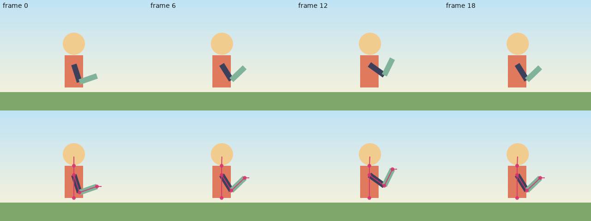

# Primeiros passos com o ARMATURA

Este guia leva você de um checkout recém-feito até um pequeno personagem animado que você construiu, fez o rig,
animou com chaves, colocou em loop, renderizou e exportou usando apenas a linha de comando. Todos os comandos abaixo foram
executados de verdade enquanto esta página era escrita; as saídas mostradas são as saídas que foram impressas.

Como foi verificado: Linux, `rustc 1.97.0`, `ffmpeg 6.1.1` e o build de **depuração** do binário
(`cargo build -p armatura-cli`). Um build de release executa o mesmo código mais rápido. Nenhuma versão mínima
suportada do Rust é declarada no repositório; a 1.97.0 é simplesmente o compilador que foi testado.

Licença da documentação: CC-BY-4.0. Veja também [RIGGING_GUIDE.md](RIGGING_GUIDE.md),
[ANIMATION_GUIDE.md](ANIMATION_GUIDE.md), [STUDIO.md](STUDIO.md), [FAQ.md](FAQ.md) e a lista completa de
comandos em [CLI_REFERENCE.md](CLI_REFERENCE.md).

## 1. O que você precisa

| Requisito | Necessário para | Observações |
|---|---|---|
| Toolchain Rust (`rustc`, `cargo`) | compilar o ARMATURA | instale a partir de <https://rustup.rs>; canal stable |
| Um navegador web | o estúdio (`armatura studio`) | apenas o Chromium foi testado, veja [STUDIO.md](STUDIO.md) |
| `ffmpeg` no `PATH` (opcional) | `.mp4`, `.webm`, mixagem de som em vídeo/HTML, `sound mix`, `face-track` em um arquivo de vídeo | todo o resto funciona sem ele |

Sem o `ffmpeg`, os comandos que dependem dele terminam com uma mensagem clara e não gravam nada:

```
$ PATH=/nonexistent armatura export buddy-final.json o.mp4
cannot run ffmpeg (No such file or directory (os error 2)); install it or export a GIF/HTML instead
```

Não há requisito de GPU. O renderizador de GPU opcional (`render-gpu`) não faz parte do build padrão.

## 2. Compile

A partir da raiz do repositório:

```
cargo build --release -p armatura-cli
```

O binário é `target/release/armatura`. Coloque-o no seu `PATH` ou crie um alias:

```
export PATH="$PWD/target/release:$PATH"      # or: alias armatura=$PWD/target/release/armatura
armatura --version
```

`--version` exibe a versão, a licença (AGPL-3.0-or-later para a CLI e o estúdio, MPL-2.0 para as
bibliotecas do motor) e a oferta de código-fonte. Executar `armatura` sem argumentos exibe o uso completo;
`armatura <command> --help` exibe o uso de um único comando.

Você também pode executá-lo sem instalar: `cargo run --release -p armatura-cli -- demo demo.json`.

Compilar a ferramenta de linha de comando com `--no-default-features` remove o comando `script` (o motor de
scripts Rhai); este tutorial usa `script`, portanto mantenha os recursos padrão.

## 3. Primeiros passos com a demonstração integrada

`armatura demo` grava um projeto de exemplo completo: um braço com skinning, uma perna com IK, uma camada de troca de lip-sync,
um fundo com paralaxe e um movimento de câmera.

```
$ armatura demo demo.json
wrote demo.json
$ armatura check demo.json
ok: 'ARMATURA demo' 640×480 @ 24 fps, 48 frames, 6 bones, 1 ik, 14 layers, 14 channels
```

`check` compila o projeto exatamente como o renderizador faria, portanto um projeto que passa em `check` pode ser
renderizado. Agora desenhe um quadro estático, com os ossos sobrepostos, e exporte uma animação:

```
$ armatura render demo.json 12 frame12.png --bones
wrote frame12.png
$ armatura render demo.json 12 frame12.svg
wrote frame12.svg
$ armatura export demo.json demo.gif
wrote demo.gif
$ armatura export demo.json demo.html
wrote demo.html
$ armatura export demo.json demo.lottie
warning: [gradient-anisotropic] shadow: a gradient on a layer with non-uniform scale or skew is approximated (Lottie gradients are not sheared)
wrote demo.lottie
```

O que você acabou de fazer:

* `render <project> <frame> <out.png|out.svg>` desenha um quadro. `--bones` sobrepõe o esqueleto,
  `--scale N` renderiza em N vezes o tamanho do canvas (0 < N <= 16).
* `export` escolhe o formato pela extensão do arquivo: `.gif`, `.html` (uma página de player autônoma),
  `.json` (Lottie), `.lottie` (dotLottie), `.apng`, `.webm`, `.mp4`, `.glb`, `.png` (sprite sheet).
* As linhas `warning:` são a parte honesta: o Lottie não consegue representar tudo o que o ARMATURA consegue. Cada
  limitação é impressa no stderr, e `--report r.json` grava a mesma lista como JSON.
* Abra `demo.html` em um navegador para reproduzir a animação; nenhum servidor e nenhuma rede estão envolvidos.

Para explorar de forma interativa:

```
armatura studio demo.json --port 8080
```

e abra <http://127.0.0.1:8080/>. Veja [STUDIO.md](STUDIO.md).

## 4. Um tutorial de 15 minutos: um personagem acenando

Você vai construir o "Buddy" a partir de um projeto vazio. O arquivo de projeto é JSON, mas você nunca precisa escrever
mais do que um cabeçalho: o comando `script` executa um pequeno script [Rhai](https://rhai.rs) em sandbox por meio
do mesmo editor validado que o estúdio usa. Se uma requisição de um script for rejeitada, *nada* é aplicado
(tudo ou nada), de modo que um script ruim nunca deixa um arquivo editado pela metade.

Trabalhe em um diretório vazio. Cada passo grava um novo arquivo numerado, para que você sempre possa voltar atrás.

### Passo 1: um projeto vazio (1 minuto)

```
cat > buddy.json <<'EOF'
{"format": 1, "name": "Buddy", "width": 320, "height": 240, "fps": 24, "frames": 24}
EOF
armatura check buddy.json
```
```
ok: 'Buddy' 320×240 @ 24 fps, 24 frames, 0 bones, 0 ik, 0 layers, 0 channels
```

Essas seis chaves são o mínimo. 24 quadros a 24 fps é um segundo, que será o nosso loop.

### Passo 2: formas (2 minutos)

As camadas são desenhadas de trás para a frente, na ordem em que você as adiciona. Crie `shapes.rhai`:

```
add_gradient_rect("sky", 0, 0, 320, 240, "#bfe3f5", "#fdf3d8");
add_rect("ground", 0, 200, 320, 40, "#7fa66b");
add_rect("torso", 140, 120, 40, 70, "#e07a5f");
add_circle("head", 160, 95, 24, "#f2cc8f");
add_rect("upper_arm", 160, 134, 40, 12, "#3d405b");
add_rect("forearm", 200, 134, 40, 12, "#81b29a");
```
```
$ armatura script buddy.json 01-shapes.json shapes.rhai
6 request(s) applied; wrote 01-shapes.json
```

As coordenadas são unidades do canvas, com a origem no canto superior esquerdo e o eixo y apontando para baixo. O braço é desenhado
na horizontal, com o ombro em (160, 140), porque essa é a pose em que vamos construir seus ossos.

### Passo 3: ossos, hierarquia e anexação da arte (3 minutos)

Um osso tem um nome, um pai (vazio = raiz), um comprimento, uma posição da cabeça (`x`, `y`) no espaço do pai
(para uma raiz: no canvas) e um ângulo de repouso em graus relativo ao pai. O ângulo 0 aponta ao longo de +x,
e os ângulos positivos giram no sentido horário na tela, de modo que 90 aponta para baixo e -90 aponta para cima.
Crie `bones.rhai`:

```
add_bone("body", "", 70, 160, 190, -90);
add_bone("neck", "body", 20, 70, 0, 0);
add_bone("arm_up", "body", 40, 50, 0, 90);
add_bone("arm_low", "arm_up", 40, 40, 0, 0);
add_bone("hand_ctrl", "", 10, 210, 165, 0);
set_layer("torso", "bone", "body");
set_layer("head", "bone", "neck");
set_layer("upper_arm", "bone", "arm_up");
set_layer("forearm", "bone", "arm_low");
```
```
$ armatura script 01-shapes.json 02-bones.json bones.rhai
9 request(s) applied; wrote 02-bones.json
$ armatura render 02-bones.json 0 rig.png --bones --scale 2
wrote rig.png
```

Leia os ossos assim: `body` é um osso raiz em (160, 190) que aponta para cima (-90) e mede 70 de comprimento.
`neck` é seu filho; sua cabeça fica a 70 unidades ao longo de `body` (no topo). `arm_up` é outro filho de
`body`, 50 unidades acima ao longo da coluna (o ombro), girado em +90 para apontar para o lado. `arm_low` é o filho
de `arm_up`: a hierarquia significa que girar o braço superior leva o antebraço junto. `hand_ctrl` é um
osso raiz separado que usaremos como alvo do IK; ele não tem arte.

`set_layer(layer, "bone", bone)` faz uma camada acompanhar um osso *de forma rígida*: ela segue o movimento do osso
em relação à sua pose de repouso. Essa é a maneira mais simples de fazer o rig de um desenho animado feito de peças separadas. (Para
formas flexíveis, você faz o skinning de âncoras vetoriais a vários ossos; veja [RIGGING_GUIDE.md](RIGGING_GUIDE.md).)

### Passo 4: cinemática inversa (1 minuto)

Em vez de animar com chaves os ângulos do ombro e do cotovelo, deixe o solver alcançar `hand_ctrl`. Crie `ik.rhai`:

```
add_ik("arm_ik", ["arm_up", "arm_low"], "hand_ctrl", 1);
```
```
$ armatura script 02-bones.json 03-ik.json ik.rhai
1 request(s) applied; wrote 03-ik.json
```

O último argumento é a direção da dobra: +1 ou -1 escolhe para que lado o cotovelo dobra. Uma cadeia de dois ossos usa
um solver analítico; cadeias de três ou mais ossos usam FABRIK. A partir de agora, mover `hand_ctrl`
move o braço inteiro.

### Passo 5: chaves e easing (3 minutos)

`set_key(target, property, frame, value, ease)` cria chaves. Para um osso, `bone_angle`, `bone_scale`,
`bone_offset_x` e `bone_offset_y` são *deltas em relação à pose de repouso*, portanto um valor de chave 0 significa
"repouso". O nome do easing se aplica ao segmento que *começa* naquela chave. Crie `keys.rhai`:

```
set_key("hand_ctrl", "bone_offset_y", 0, 0, "ease_in_out");
set_key("hand_ctrl", "bone_offset_y", 12, -75, "ease_in_out");
set_key("hand_ctrl", "bone_offset_y", 24, 0, "ease_in_out");
set_key("neck", "bone_angle", 0, 0, "smooth");
set_key("neck", "bone_angle", 16, 10, "smooth");
set_key("neck", "bone_angle", 24, 0, "smooth");
```
```
$ armatura script 03-ik.json 04-keys.json keys.rhai
6 request(s) applied; wrote 04-keys.json
$ armatura timeline 04-keys.json
timeline: 24 frames at 24 fps, 2 channels
Bones
  hand_ctrl
    #0 bone_offset_y (keys @ 0 12 24)
  body
    neck
      #1 bone_angle (keys @ 0 16 24)
```

Os nomes de easing que não precisam de parâmetros são `linear`, `step`, `ease_in`, `ease_out`, `ease_in_out`,
`smooth` e `bounce`. `bezier:x1,y1,x2,y2` é aceito por `keyedit`, e `spring` e `back` recebem
parâmetros (veja [PROJECT_FORMAT.md](PROJECT_FORMAT.md)). A mão e a cabeça usam tempos diferentes de propósito: a ação sobreposta
transmite vida.

### Passo 6: faça-o entrar em loop (1 minuto)

Os dois canais começam e terminam com o mesmo valor (o quadro 24 repete o quadro 0), que é o que um loop precisa.
`loop-solve` verifica a emenda e configura os canais para loop:

```
$ armatura loop-solve 04-keys.json buddy-final.json
wrote buddy-final.json: 2 channel(s) adjusted, seam 0.000 -> 0.000
$ armatura lint buddy-final.json
0 finding(s), 0 error(s)
```

"seam 0.000 -> 0.000" significa que a última pose já é igual à primeira, portanto nada precisou ser corrigido. Um
projeto de N quadros reproduz os quadros 0..N-1 repetidamente, de modo que o quadro N é a mesma pose que o quadro 0 e nunca é
mostrado duas vezes. Se você criar um loop de modo que o *último quadro exibido* seja igual ao primeiro, passe `--inclusive`
(a convenção mais antiga). Se a sua animação tem deslocamento líquido, `make-loop` o remove. Veja
[ANIMATION_GUIDE.md](ANIMATION_GUIDE.md).

`lint` executa verificações estáticas de rig e de animação (alvos de IK inalcançáveis, canais mortos, ossos ausentes...);
ele termina com código 1 quando encontra erros, portanto é seguro colocá-lo em um script ou em um job de CI.

### Passo 7: veja e renderize (2 minutos)

```
$ armatura stats buddy-final.json
```
imprime um resumo em JSON (aqui: 5 ossos, 1 cadeia de IK, 6 camadas, 2 canais, 6 chaves). Renderize quadros estáticos e uma
sequência completa de quadros:

```
$ armatura render buddy-final.json 12 frame12.png --scale 2
wrote frame12.png
$ armatura render buddy-final.json 12 frame12.svg
wrote frame12.svg
$ armatura frames buddy-final.json frames --png
wrote 24 frames to frames
$ ls frames | head -3
frame_0000.png
frame_0001.png
frame_0002.png
```



Sem `--png`, `frames` grava arquivos SVG. As renderizações são determinísticas: o mesmo projeto e o mesmo quadro produzem
os mesmos bytes em qualquer máquina com o mesmo build, o que torna possíveis as verificações de quadros de referência de
[ANIMATION_GUIDE.md](ANIMATION_GUIDE.md).

### Passo 8: exporte (2 minutos)

```
$ armatura export buddy-final.json buddy.gif
wrote buddy.gif
$ armatura export buddy-final.json buddy.html
wrote buddy.html
$ armatura export buddy-final.json buddy.json --report buddy-report.json
wrote buddy.json
$ cat buddy-report.json
{
  "count": 0,
  "format": "lottie",
  "warnings": []
}
$ armatura export buddy-final.json buddy.mp4        # needs ffmpeg
wrote buddy.mp4
$ armatura export buddy-final.json buddy.apng
wrote buddy.apng
```

Tamanhos de arquivo deste projeto minúsculo: GIF 145 KB, JSON Lottie 21 KB, player HTML 50 KB, APNG 75 KB, MP4 6 KB.
`buddy.json` é Lottie; ele tem uma lista de avisos vazia porque o Buddy usa apenas recursos que o Lottie consegue
expressar. O arquivo HTML é um player autônomo (abra-o em qualquer navegador).

Algumas regras que vale a pena lembrar:

* `export` e `render` **se recusam a sobrescrever o projeto de entrada** (`refusing to overwrite the input
  project buddy-final.json with output of the same name`) e se recusam a gravar através de um link simbólico
  a menos que você passe `--follow-symlinks`. Os comandos que transformam um projeto em outro
  (`script`, `loop-solve`, `walk`, `autorig`...) *não* têm essa verificação: eles gravam de forma atômica, de modo que
  `armatura script p.json p.json x.rhai` edita no próprio arquivo. Use nomes distintos até confiar em um script.
* O GIF tem 256 cores e transparência de 1 bit; para um alfa suave, use `.apng` ou `.webm`.
* Execute `armatura export-fit` (veja [ANIMATION_GUIDE.md](ANIMATION_GUIDE.md)) quando precisar atingir um orçamento de bytes.

### Passo 9 (opcional): edite no estúdio

```
armatura studio buddy-final.json --port 8080
```

Arraste as camadas, selecione uma chave no dope sheet e pressione `Space` para reproduzir. Nada é gravado no seu arquivo
até que você pressione **Save** (`Ctrl+S`).

## 5. Como as peças se encaixam

| Conceito | No arquivo | Você o cria com |
|---|---|---|
| Camada (vetor, imagem, grupo, troca...) | `layers` | `add_rect`, `add_circle`, `add_polygon`, `add_line`, `import-svg`, `autotrace`... |
| Osso | `bones` (pais antes dos filhos) | `add_bone`, `set_parent`, `reparent` |
| Cadeia de IK / restrição / mola | `ik`, `constraints`, `springs` | `add_ik`, `add_aim`, `add_copy_rotation`, `add_pin`; molas por JSON |
| Canal (uma propriedade animada) | `channels` | `set_key`, `keys`, `keyedit`, expressões, noise, bakes |
| Clipe, take, máquina de estados, binding | `clips`, `machines`, `bindings` | `take-record`, `clip`, `machine`, `bind` |

Tudo é JSON puro, e é por isso que os diffs (`armatura diff a.json b.json`), o controle de versão
(`armatura vcs`) e os scripts funcionam. Campos desconhecidos são relatados como avisos e ignorados:

```
$ armatura check unk.json
warning: unknown field bogus (ignored)
ok: 'X' 100×100 @ 24 fps, 10 frames, 0 bones, 0 ik, 0 layers, 0 channels
```

Um projeto só pode referenciar arquivos de imagem e de som **dentro do seu próprio diretório**. Caminhos absolutos e `..`
são recusados, a menos que você passe `--allow-external-assets` (veja [FAQ.md](FAQ.md)).

## 6. Para onde ir em seguida

* Faça o rig de algo flexível (skins, pesos, lattice, cage, tecido, física): [RIGGING_GUIDE.md](RIGGING_GUIDE.md).
* Ciclos de caminhada, pilhas de clipes, lip-sync, mocap, máquinas de estados, QA e orçamentos de tamanho:
  [ANIMATION_GUIDE.md](ANIMATION_GUIDE.md).
* O editor no navegador, seus atalhos e a API HTTP: [STUDIO.md](STUDIO.md).
* Perguntas e mensagens de erro: [FAQ.md](FAQ.md). Limitações conhecidas: [LIMITATIONS.md](LIMITATIONS.md).
* Todos os comandos e flags: [CLI_REFERENCE.md](CLI_REFERENCE.md); o formato de arquivo: [PROJECT_FORMAT.md](PROJECT_FORMAT.md).
